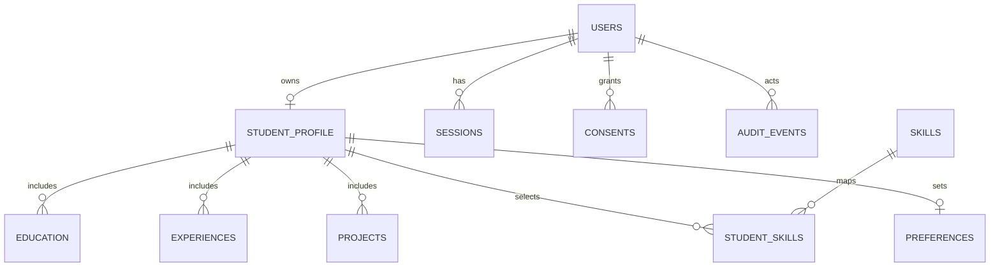

# Sprint 1 design handoff

## Decisions

- Runtime: Node.js 20+, native HTTP server and built-in modules; no runtime package install.
- Local persistence: `data/db.json` for a disposable prototype. Production/staging must use a transactional database and managed session storage.
- Identity: UUID user IDs, explicit `student` and `employer` roles, owner-scoped profile endpoints, default-private profile visibility.
- Password hashing: Node `scrypt` keeps the prototype dependency-free. The original Sprint 1 criterion names Argon2/bcrypt; switching algorithms requires a reviewed dependency decision and hash-version migration.
- Session: random opaque ID in an HttpOnly, SameSite=Lax cookie, seven day expiry, Secure flag in production. Sign-in lock and request windows currently live in process memory, so replicas do not share enforcement.
- Verification/reset token: random, single-use, 15 minute token; only HMAC digest is persisted. Local mode returns a development link. Production email delivery is a deployment dependency.
- API errors: JSON `{ "error": "..." }`; 400 validation, 401 unauthenticated, 403 forbidden/unverified, 409 conflict, 429 rate limit.

## ERD

`migrations/001_sprint1.up.sql` and `.down.sql` define the PostgreSQL target and rollback. They are design deliverables; the Node prototype still reads/writes JSON. Do not present those migrations as applied to staging.

## UI handoff

- Landing page: explain the two-sided product; label candidate/job cards as illustrative; CTA enters the correct student/employer registration role.
- Registration: role selection, consent, validation, verification feedback.
- Onboarding: 3 resumable steps for industry/major/school, target role/job type, location; skip allowed.
- Student profile: personal and education data, skills, experience, projects, languages, preferences and visibility; save confirmation and completion indicator.
- States: modal loading via disabled submit while saving, empty category fallback, inline validation errors, toast success, 401 session-expired message.
- Responsive rules: mobile nav exposes `aria-expanded`; dialog remains scrollable with keyboard controls.

The existing landing design is implemented in `public/index.html`; account/profile flows are in Sprint 1 `app.js`. There is no separate Figma file in this repository.
